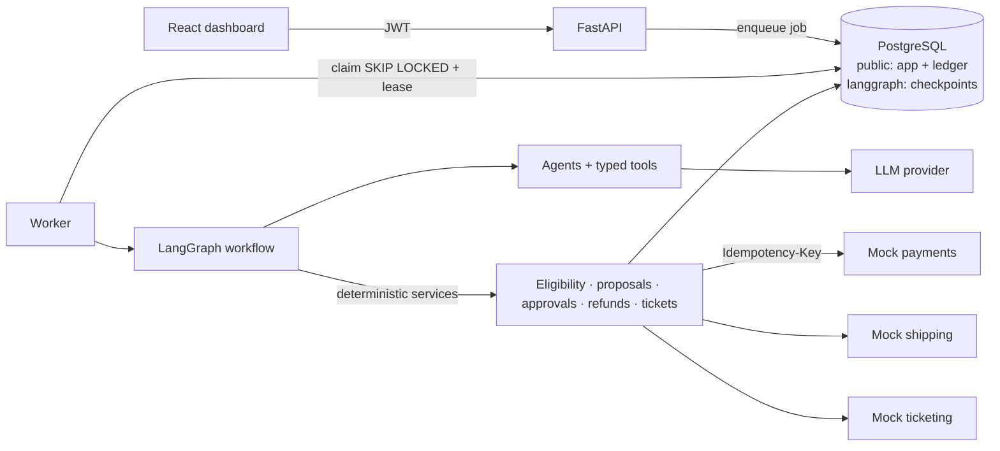
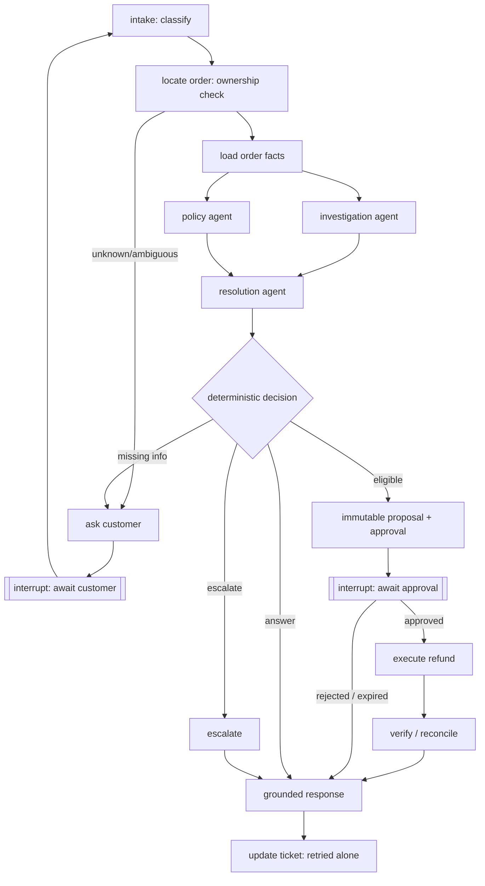

# Customer Support Resolution Agent

An agentic customer-support system that takes a complaint from investigation to a **verified business outcome**:
it identifies the customer, gathers order / return / payment / shipping facts, retrieves the applicable policy,
proposes a resolution, **pauses for human approval before any refund**, executes the approved refund through an
idempotent payment API, verifies the result with the provider, updates the ticket, and explains only what it
can prove.

> **The model proposes; the application decides and executes.** LLM agents classify, investigate, cite policy and
> draft. Identity, ownership, eligibility, amounts, approvals, retries, state transitions and every external write
> are deterministic, tested application code.

The domain is **VoltCart**, a fictional Indian electronics retailer (INR). All data is synthetic, and payment, shipping
and ticketing are mock services with configurable failures.

| | |
|---|---|
| Backend | Python 3.12 · FastAPI · LangGraph 1.2 · SQLAlchemy 2 · Alembic · Pydantic 2 · PostgreSQL 16 |
| Agents | Single tool-using baseline **or** investigation + policy + resolution specialists (concurrent branches) |
| LLM | Deterministic mock (default, free) · Anthropic Claude (`claude-opus-5-5`) · any OpenAI-compatible API |
| Frontend | React 18 + TypeScript (Vite) dashboard for customers and reviewers |
| Quality | 153 automated tests · 60-case evaluation with held-out split · GitHub Actions CI |
| Ops | Docker images, Docker Compose, single-container hosting mode, health/readiness checks |

**Status:** see [Status and verification](#status-and-verification). Documents: [architecture](docs/architecture.md) ·
[implementation plan](docs/implementation-plan.md) · [requirements checklist](docs/requirements-checklist.md) ·
[deployment](docs/deployment.md) · [evaluation](docs/evaluation.md) · [demo checklist](docs/demo-checklist.md) ·
[resume description](docs/resume.md).

---

## 1. Business problem and scope

> "I returned my headphones last week, but I still haven't received my refund."

Answering this correctly needs the customer's identity, the order, the return and inspection status, the payment
and any refunds already in flight, the refund policy *version that applied to that order*, a human decision, a
payment call that must never happen twice, and a reply that does not over-claim. The system handles three complaint
types:

| Type | What happens |
|---|---|
| **Order status** | Order + carrier tracking → latest verified status; delays beyond policy or carrier exceptions are escalated |
| **Refund request** | Order, return, payment → deterministic eligibility → proposal → reviewer approval → revalidation → idempotent execution → provider verification → ticket update |
| **Damaged item** | Order + damage policy → asks for missing details (description, photos) → refund proposal (approval) or escalation (late report, no photos, replacement) |

**Scope boundaries (by design):** one fictional store; INR only; one issue per workflow; mock payment, shipping and
ticketing services; human approval for **every** refund; customer messaging inside the demo UI; no real payments;
no chargebacks, fraud adjudication or partial returns of multi-item orders (a return covers the whole order).

## 2. Features

- **End-to-end workflow** in LangGraph with durable Postgres checkpoints, `interrupt()` pauses for customer
  clarification and reviewer approval, and `Command(resume=…)` on the same thread.
- **Concurrent specialists**: after the order facts that select the policy version are loaded, the investigation and
  policy agents run as parallel branches and join at the resolution agent. A single-agent baseline is selectable per
  run (`agent_mode`) for comparison.
- **Policy RAG** with versioned documents, section chunking, hybrid (embedding + full-text) retrieval filtered to the
  version in effect on the delivery date, citations, and missing/conflicting-policy detection.
- **Deterministic eligibility engine** (`app/services/eligibility.py`) — similarity scores and model output never
  decide eligibility; mismatched model proposals are corrected and audited.
- **Human approval** bound to a SHA-256 hash of an immutable proposal (DB trigger), reviewer approval limits, senior
  review above ₹30,000, expiry, and invalidation when facts change.
- **Safe refunds**: reserve-then-call with a database `CHECK` on refundable balance, stable idempotency keys, no
  transaction held across network calls, reconciliation of uncertain outcomes by key lookup, retries with the same key
  only when the provider has no record.
- **Failure handling** for timeouts, provider errors, invalid model output, tool-loop limits, step/cost limits,
  ticket-sync failures, worker crashes (lease expiry + checkpoint resume) — see [§10](#10-failure-recovery).
- **Audit trail** (append-only, redacted) and a run timeline in the UI.
- **Dashboard** for customers (complaints, clarifications, evidence, citations, outcome) and reviewers (approval
  queue, evidence, approve/reject, metrics, fault injection for demos).

## 3. Architecture



Workflow graph (full version with the refund sequence diagram in [docs/architecture.md](docs/architecture.md)):



| Component | Location | Responsibility |
|---|---|---|
| API | `app/main.py`, `app/api/` | Auth, authorization, validation, structured errors, 202 + job for runs, approvals, events |
| Worker | `app/worker.py` | Claims jobs (lease), runs/resumes graphs, sweeps: lease recovery, approval expiry, refund reconciliation, ticket sync |
| Workflow | `app/workflows/` | State (`state.py`), nodes, graph, validated run transitions, response templates + grounding guard |
| Agents | `app/agents/` | Classifier, investigation, policy, resolution, single baseline, responder; bounded loop with JSON validation/repair |
| Tools | `app/tools/` | Typed read/write tools, server-built `ToolContext`, per-agent allowlists enforced at dispatch |
| Services | `app/services/` | Records (ownership), eligibility, proposals, approvals, refunds, tickets, audit, jobs, external clients |
| Policies | `app/policies/` | Markdown policies with metadata, versioned rule parameters, embeddings, retrieval |
| Mock services | `mock_services/` | Payments (idempotency, conflict detection, lookup by key), shipping, ticketing, fault injection |

## 4. Agents, tools and why some steps use an LLM

| Agent | Tools (enforced) | Output |
|---|---|---|
| Classifier | none | `Classification`: category, order reference, product mentions, damage details |
| Investigation | `get_order`, `get_return_status`, `get_payment_status`, `get_shipment_status`, `get_refund_status`, `get_ticket` | `EvidenceSummary` with references to tool results |
| Policy | `search_policy` | `PolicyFinding`: citations (doc, version, section, quote), interpretation, missing/conflict flags |
| Resolution | none | `ResolutionProposal`: action, order, amount (paise), currency, reason, evidence/policy refs, missing info |
| Single (baseline) | all read tools + `search_policy` | evidence + policy + proposal in one agent |
| Responder | none | Rephrases a deterministic draft; a grounding guard rejects unverified claims/amounts |

**No agent has a write tool.** `create_refund_proposal`, `execute_approved_refund` and `update_ticket` are called
only by deterministic workflow nodes. Calling a tool outside an agent's allowlist returns `TOOL_NOT_PERMITTED`, is
audited and counted. The LLM is used where language understanding helps (classification, extraction, summarising
evidence, interpreting policy text, wording replies); everything that can be wrong in a costly way is code.

## 5. Data model

PostgreSQL schema `public` (Alembic `0001`); LangGraph checkpoints in schema `langgraph` (never used as the ledger).

| Table | Purpose / key constraints |
|---|---|
| `customers`, `staff_users` | identity mapped from JWT `sub` (`external_auth_subject`); reviewer role + approval limit |
| `products`, `orders`, `order_items` | money in **paise (BIGINT)**; `currency = 'INR'`; `refunded + reserved ≤ paid` **CHECK** |
| `returns`, `payments`, `shipments` | return/inspection status, provider payment reference, carrier tracking number |
| `tickets`, `ticket_messages` | ticket status/category, customer-visible conversation |
| `workflow_runs`, `workflow_jobs` | run status/outcome/metrics/snapshot; durable job queue with leases |
| `policy_documents`, `policy_chunks` | id, version, effective dates, source URI; chunk embeddings, `tsvector`, section metadata |
| `action_proposals` | immutable payload + `payload_hash` (trigger blocks changes) |
| `approvals` | bound to `proposal_payload_hash` (trigger-verified), reviewer, decision, `expires_at`, `decided_at`; one pending per proposal |
| `refund_operations` | **unique `idempotency_key`**, unique `proposal_id`, status `pending/submitted/processing/succeeded/failed/unknown` |
| `audit_events` | append-only (trigger), redacted payloads |

## 6. API

Interactive docs at `/docs` (OpenAPI). Every endpoint except health and demo login requires a Bearer token.

| Method & path | Who | Description |
|---|---|---|
| `POST /auth/demo-login` · `GET /auth/demo-users` · `GET /auth/me` | anyone / any | Demo personas (synthetic) |
| `POST /tickets` | customer | Create a ticket (optional `order_id`, ownership-checked) |
| `GET /tickets` · `GET /tickets/{id}` | customer (own) / reviewer | List / detail with conversation |
| `POST /tickets/{id}/runs` | customer | Start a workflow → **202** + `run_id` (409 if one is active) |
| `GET /runs/{id}` · `GET /runs/{id}/events` | owner / reviewer | Status, verified state, outcome; redacted timeline |
| `POST /runs/{id}/messages` | customer | Answer a clarification (409 unless awaiting the customer) |
| `GET /approvals` · `GET /approvals/{id}` | reviewer | Queue with evidence, citations, expiry, `can_approve` |
| `POST /approvals/{id}/decision` | reviewer | approve/reject; limits, senior review, expiry (410), double-decision (409) enforced |
| `GET /orders` | customer | Own orders (complaint form) |
| `GET /health` · `GET /health/ready` | public | Liveness incl. DB; readiness incl. migration, seed, policies, mock services |
| `/demo/faults`, `/demo/provider-refunds`, `POST /demo/reset` | reviewer (demo mode) | Fault injection and demo reset |

Errors are always `{"error": {"code", "message", "retryable", "details"}}` with appropriate status codes.

## 7. Policy retrieval

Six synthetic policy documents (`app/policies/documents/`): refund eligibility **v1** (delivered ≤ 30 Jun 2026,
30-day window) and **v2** (from 1 Jul 2026, 21-day window), return processing, damaged products (7-day window,
description + photos), shipping delays (escalate > 3 days late), and exceptions requiring human review.

`python -m scripts.ingest_policies` parses metadata, splits by section, embeds (local deterministic feature-hashing
by default; OpenAI-compatible embeddings optional), and stores chunks with section references. `search_policy`
filters to documents in effect on the order's delivery date, ranks with 0.6·cosine + 0.4·`ts_rank`, and reports
missing topics and conflicting versions. The decision node removes citations of non-applicable versions and attaches
the governing document's sections if the agent missed them. Retrieved text is marked untrusted and has no authority.
pgvector is not required (corpus is small); see [limitations](#14-limitations-and-future-work).

## 8. Authentication and authorization

- JWT (HS256) with issuer/audience/expiry checks. Demo mode issues tokens for synthetic personas; a real deployment
  would use an external IdP — only the verified `sub` claim is needed.
- Customer identity comes **only** from the token; request bodies cannot set it, and tools receive a server-built
  context. A foreign or non-existent order returns the same `ORDER_NOT_FOUND` (no existence leak).
- Reviewer endpoints require the reviewer role; reviewer identity comes from the token. Approvals enforce approval
  limits (₹30,000 for reviewers) and senior review above the policy threshold.
- The mock payment provider requires a server-side API key; mock admin endpoints require an admin token, proxied
  through reviewer-only `/demo/*` endpoints so the token never reaches the browser.

## 9. Approval and transaction safety

1. The proposal (validated against the deterministic decision) is stored immutably with a payload hash.
2. A pending approval is bound to that hash; the workflow pauses with `interrupt()`.
3. The reviewer's decision is persisted, then a resume job continues the **same thread**. The node re-reads the
   decision from the database — the resume payload and chat messages carry no authority.
4. Execution (a separate node from the interrupt) re-verifies the stored approval (decision, reviewer, hash, expiry,
   limits) and **re-runs eligibility under a row lock**. If anything material changed, the approval is invalidated and
   a new proposal/approval is required.
5. TX1 reserves the amount and creates the refund operation with key `refund-<proposal_id>`; commit. Mark
   `submitted`; commit. Call the provider. Persist the response: settle, mark processing, fail (release), or mark
   **unknown** and reconcile by key lookup before any retry.

Week-3 acceptance (`tests/failure_scenarios/test_recovery.py`): crashes at four points in this sequence, timeouts after
provider acceptance, 5xx before acceptance and concurrent executions all end with **exactly one** provider refund.

## 10. Failure recovery

| Failure | Behaviour |
|---|---|
| Missing / ambiguous order | Targeted question listing only the customer's own orders; resume on reply (max 2 rounds, then escalate) |
| Cross-customer order | Same response as a non-existent order; audited |
| No applicable / conflicting policy | Escalate (`no_applicable_policy` / `conflicting_policy`) |
| Read API failure | Bounded exponential backoff; persistent outage → escalate with an honest message |
| Invalid model output | Schema validation + 1 repair attempt → escalate |
| Tool loop / excessive steps / cost | Agent iteration limit; workflow step & cost limits → escalate |
| Rejected / expired approval | Recorded; customer told no refund was issued |
| Uncertain refund (timeout/5xx) | `unknown` → lookup by idempotency key → adopt result or re-send with the same key; unresolved → escalate, reservation held |
| Refund OK, ticket update fails | Only the ticket update is retried (bounded); a sweeper re-syncs later with the same idempotency key |
| Worker crash | Job lease expires → re-queued → graph continues from the last checkpoint; side-effecting nodes are idempotent; sweeper reconciles refunds |
| Ledger vs provider disagree | Escalate before any new refund |
| Database outage | `503 DATABASE_UNAVAILABLE` (retryable) |

## 11. Local setup

Prerequisites: Python 3.12 with [uv](https://docs.astral.sh/uv/), Node 22, PostgreSQL 16 (or Docker).

```bash
cp .env.example .env                       # defaults work locally; no API keys needed
uv sync --frozen --all-extras              # backend deps from uv.lock
(cd frontend && npm ci)                    # frontend deps from package-lock.json
createdb support_agent                     # or use Docker (below)

uv run uvicorn mock_services.main:app --port 8001          # terminal 1: mock services
uv run python -m scripts.bootstrap --reset-demo            # migrate + checkpoints + seed + policies
RUN_EMBEDDED_WORKER=true uv run uvicorn app.main:app --port 8000   # terminal 2: API + worker
(cd frontend && npm run dev)               # terminal 3: http://localhost:5173
```

### Docker

```bash
cp .env.example .env
docker compose up --build -d     # db, mocks, bootstrap (one-shot), api, worker, frontend
docker compose ps                # all services healthy; bootstrap exited 0
open http://localhost:8080       # dashboard;  http://localhost:8000/docs for the API
```

Startup ordering is health-gated: `bootstrap` waits for a healthy database and mock services; `api` and `worker`
start only after `bootstrap` completes successfully. Behind a TLS-intercepting proxy, pass a CA bundle as a build
secret: `docker build --secret id=extra_ca,src=/path/ca.pem …` (used only during dependency install).

## 12. Configuration

All settings are environment variables, validated at startup (`app/config.py`); see [`.env.example`](.env.example).
Production refuses to start with the development JWT secret, the default mock admin token, or wildcard CORS.

| Variable | Default | Notes |
|---|---|---|
| `DATABASE_URL` | local Postgres | `postgres://` / `postgresql://` URLs are normalised |
| `CORS_ORIGINS` | localhost:8080, 5173 | explicit list |
| `JWT_SECRET`, `DEMO_AUTH_ENABLED` | dev secret, `true` | ≥ 32 chars in production |
| `LLM_PROVIDER`, `LLM_MODEL`, `LLM_API_KEY`, `LLM_EFFORT` | `mock`, —, —, `medium` | `anthropic` uses `claude-opus-5-5` by default with server-side refusal fallback; a missing key falls back to `mock` with a warning in `/health` |
| `EMBEDDING_PROVIDER` | `local` | `openai` for an OpenAI-compatible embeddings endpoint |
| `AGENT_MODE` | `specialist` | or `single` |
| `MAX_WORKFLOW_STEPS`, `MAX_COST_USD_PER_RUN`, `MAX_AGENT_ITERATIONS`, `MAX_READ_RETRIES`, `APPROVAL_TTL_MINUTES` | 40, 0.50, 6, 3, 1440 | limits |
| `RUN_EMBEDDED_WORKER` | `false` | `true` for single-process hosting |
| `VITE_API_BASE_URL` | — | **frontend build time** |

**Which features need an LLM key?** None. The default deterministic mock exercises the full workflow, tools,
validation and recovery. With `LLM_PROVIDER=anthropic` and a key, real model calls replace the mock for
classification, investigation, policy interpretation, proposal drafting and reply wording; all controls stay the
same. *The real-provider path is implemented and unit-tested with a stubbed client but was not run against a live
API in this project (no key was available).*

## 13. Testing and evaluation

```bash
make lint typecheck        # ruff + format check + tsc; mypy
make test                  # 153 tests (needs PostgreSQL; TEST_DATABASE_URL, default support_agent_test)
make evals                 # 60 cases × 2 agent designs → evals/reports/latest.md
uv run python -m scripts.smoke_api --base-url http://localhost:8000 --reset   # API smoke against a running stack
UI_URL=http://localhost:8080 node tests/e2e/ui_smoke.cjs                      # browser smoke (Playwright)
```

### Evaluation results (actual, mock LLM)

From [`evals/reports/latest.md`](evals/reports/latest.md) — 60 cases (48 dev, 12 held-out written before running and
never tuned against), money verified from the ledger and the mock provider, grounding checked deterministically:

| Metric | Single agent | Specialists |
|---|---|---|
| Workflow correctness | 59/60 (98%) | 59/60 (98%) |
| Held-out correctness | 11/12 | 11/12 |
| Verified resolution (automated / human-assisted) | 46 (23 / 23) | 46 (23 / 23) |
| Unauthorized actions executed · duplicate refunds | 0 · 0 | 0 · 0 |
| Policy retrieval hit · wrong-version citations | 56/57 · 0 | 56/57 · 0 |
| Grounded responses | 58/58 | 58/58 |
| Mean model calls / case | 4.1 | 7.05 |
| Mean estimated cost / case | $0.030 | $0.034 |

The single held-out failure (B09, "Sent the BoomBox speaker back — haven't seen the money yet") is a classifier miss:
the system asked a clarifying question instead of starting a refund — a safe failure. **In mock mode these numbers
measure the system (orchestration, controls, recovery), not language-model quality**; with this deterministic stand-in
the specialist design adds ~72% more model calls and ~13% cost without a correctness gain. Rerun with a real model to
compare designs meaningfully. Details and caveats: [docs/evaluation.md](docs/evaluation.md).

## 14. Limitations and future work

- Real LLM providers are implemented but unverified against live APIs here; the mock's classifier is keyword-based
  (see B09).
- Demo JWT login instead of an external identity provider; no rate limiting.
- Local embeddings are lexical feature hashing; pgvector and semantic embeddings are optional future work.
- Whole-order returns only; no partial returns, chargebacks or fraud handling; replacements are escalated.
- Customer clarifications have no timeout; abandoned runs stay `awaiting_customer`.
- Single-container hosting runs mocks/worker in one process group; free hosting sleeps when idle (cold starts).

## Status and verification

See [docs/requirements-checklist.md](docs/requirements-checklist.md) for every requirement with its verification, and
[docs/deployment.md](docs/deployment.md#verification-gate) for the deployment gate results.

## Repository layout

```
app/            api/ auth/ agents/ db/ llm/ policies/ schemas/ services/ tools/ workflows/ main.py worker.py config.py
mock_services/  payments/ shipping/ ticketing/ (one FastAPI app, SQLite-backed, fault injection)
migrations/     Alembic (0001: schema, constraints, triggers)
scripts/        bootstrap, seed_data, ingest_policies, smoke_api, start.sh
evals/          datasets/cases.yaml, run_evals.py, reports/
tests/          unit/ integration/ failure_scenarios/ e2e/
frontend/       React + TypeScript dashboard
docs/           architecture, implementation plan, requirements checklist, deployment, evaluation, demo, resume
```

Deviations from the suggested layout: shipping/ticketing/payments mocks share one process (`mock_services/main.py`)
to keep hosting simple; LLM adapters live in `app/llm/`; a `scripts/bootstrap.py` combines setup steps.
