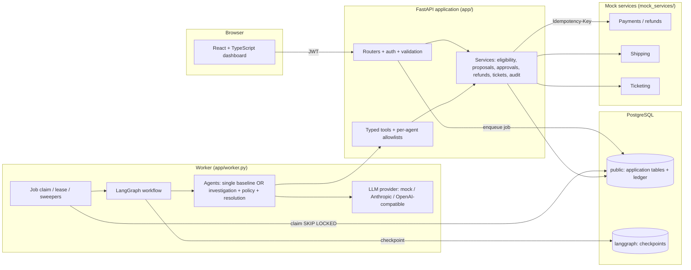
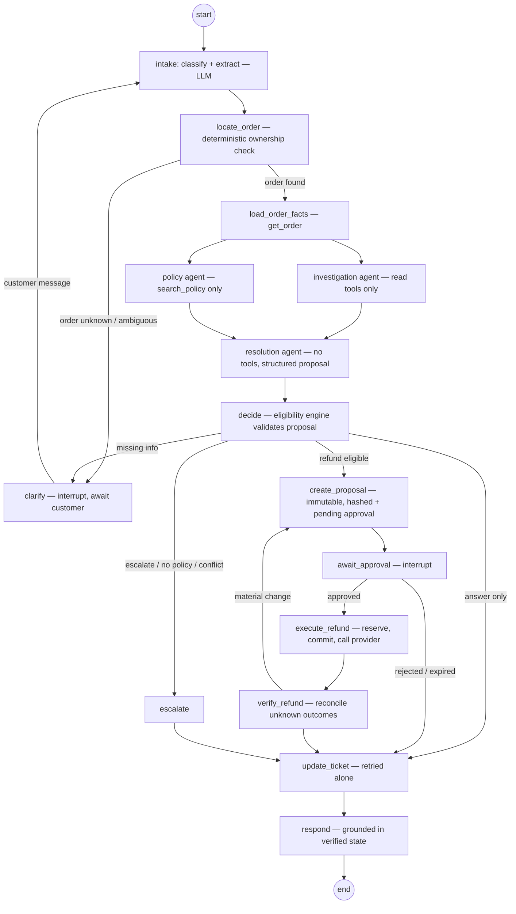
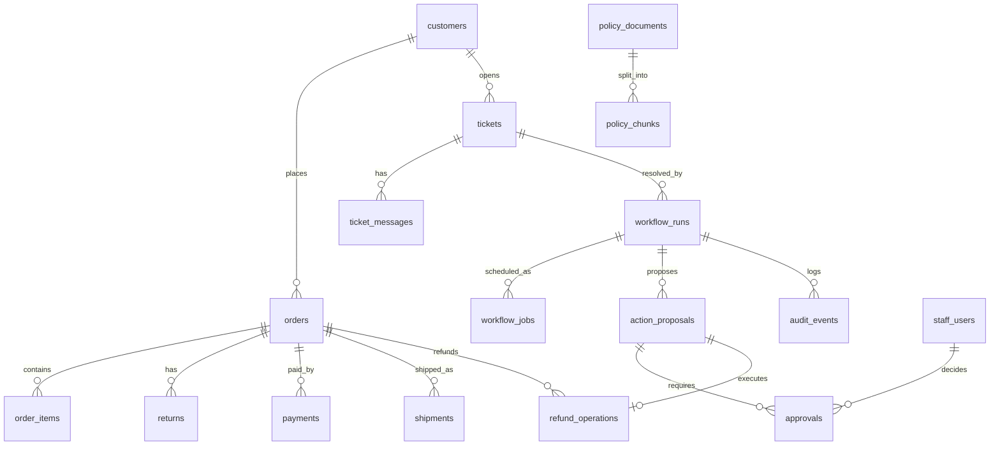

# Architecture — Customer Support Resolution Agent

## 1. Purpose and principle

The system takes a customer complaint for a fictional electronics retailer
("VoltCart", INR only) from investigation to a **verified** business outcome.

> **The model proposes; the application decides and executes.**
> LLM output is advisory text and structured proposals. Identity, ownership,
> amounts, eligibility, approval validity, state transitions, retries and all
> external writes are deterministic application code.

## 2. Components



| Component | Responsibility |
|---|---|
| FastAPI (`app/main.py`, `app/api/`) | Customer requests, demo authentication, authorization on every endpoint, workflow creation (202 + job), status queries, reviewer decisions, customer follow-up messages, validation, structured errors, OpenAPI |
| Worker (`app/worker.py`) | Claims durable jobs, runs/resumes the LangGraph graph, expires approvals, reconciles uncertain refunds, re-queues jobs whose lease expired (crash recovery) |
| LangGraph workflow (`app/workflows/`) | Classification, order resolution, concurrent investigation and policy retrieval, proposal, approval pause, controlled execution, verification, ticket update, escalation, response |
| PostgreSQL | Application data, financial ledger (`refund_operations`, order balance columns), audit events (schema `public`), LangGraph checkpoints (schema `langgraph`) |
| Mock services | Payment/refund API (idempotency keys, payload-conflict detection, lookup by key), shipping tracking API, ticketing API; all with configurable errors, delays, timeouts and "commit then time out" faults |

## 3. Workflow graph



In **single-agent mode** (`AGENT_MODE=single`) the `inv`, `pol` and `res`
nodes are replaced by one tool-using agent with all read tools and
`search_policy`. Everything around it is identical, which makes the comparison
fair (`evals/run_evals.py --agent-mode both`).

### Why investigation and policy run in parallel *after* `load_order_facts`

Which policy version applies depends on the order's `delivered_at` date and
product category. Those facts are loaded first by a cheap deterministic read;
then the investigation agent (returns, payments, shipping) and the policy agent
(retrieval filtered to the applicable version) are independent and run as
parallel LangGraph branches that join at `resolve`.

## 4. LLM vs deterministic responsibilities

| Uses the LLM | Deterministic application code |
|---|---|
| Classify complaint category; extract order reference / product mention / damage details | Customer identity (from JWT), ownership checks, access denial |
| Investigation summary over tool results | Which tools each agent may call (enforced at dispatch) |
| Policy interpretation text with citations | Policy version selection by effective dates, conflict detection |
| Draft resolution proposal (action, reason, references) | Eligibility rules, refundable balance, amount calculation |
| Customer-facing explanation (constrained to verified facts) | Approval creation, hashing, expiry, reviewer permission |
| | Reserve/commit, idempotency key, provider call, reconciliation |
| | State transitions, retry limits, step/cost limits |

If the model's proposed amount, order or action differ from the deterministic
computation, the deterministic result wins and a `proposal_corrected` /
`proposal_rejected` audit event is recorded. Similarity scores never establish
eligibility.

## 5. State model

`ResolutionState` (Pydantic, `app/workflows/state.py`) contains the
specified fields: `run_id`, `ticket_id`, `authenticated_customer_id`,
`order_id`, `complaint_category`, `customer_message`, `verified_facts`,
`policy_references`, `missing_information`, `proposed_action_id`,
`approval_id`, `execution_status`, `external_result_reference`,
`retry_counts`, `error_details`, `final_response`, plus counters (`step_count`,
`model_calls`, `tool_calls`, `estimated_cost_usd`). Parallel branches write
disjoint keys; counters use additive reducers.

Run statuses (`workflow_runs.status`) and allowed transitions are defined in
`app/workflows/transitions.py` and enforced on every update:

```
queued → running
running → awaiting_customer | awaiting_approval | executing | completed | escalated | failed
awaiting_customer → queued (message received) | expired
awaiting_approval → queued (decision recorded or approval expired)
executing → reconciling | running | completed | escalated | failed
reconciling → running | escalated
completed, escalated, failed, rejected, expired → terminal
```

Outcomes (`workflow_runs.outcome`): `answered`, `refund_succeeded`,
`refund_rejected`, `approval_expired`, `escalated`, `clarification_needed`,
`failed`.

## 6. Data model



Key financial rules (enforced in the database where possible):

- Money is `BIGINT` paise; currency `CHECK (currency = 'INR')`.
- `refund_operations.idempotency_key` is `UNIQUE`; `proposal_id` is `UNIQUE`
  (one operation per approved proposal).
- `orders.refunded_amount_minor + orders.reserved_refund_minor <= paid_amount_minor`
  (`CHECK`), both `>= 0`. Reservation, settlement and release update these in
  the same transaction as the operation status, under `SELECT … FOR UPDATE` on
  the order row.
- `approvals.proposal_payload_hash` records the exact proposal approved;
  execution recomputes the hash of the stored proposal and compares.
- At most one pending approval per proposal (partial unique index).

The LangGraph checkpoint tables live in schema `langgraph` and are **not**
consulted for financial decisions; the execution service always re-reads
`refund_operations` and asks the provider.

## 7. Refund execution and recovery

```mermaid
sequenceDiagram
    participant W as Worker (execute node)
    participant DB as PostgreSQL
    participant P as Mock payment API
    W->>DB: TX1 lock order+proposal+approval; verify approval, hash, expiry;<br/>re-run eligibility; insert refund_operation(pending); reserve amount; COMMIT
    W->>P: POST /refunds (Idempotency-Key: refund-<proposal_id>)
    alt 2xx succeeded
        W->>DB: TX2 status=succeeded, reserved→refunded, provider_reference
    else 2xx processing
        W->>DB: status=submitted (verify node polls)
    else 4xx definitive
        W->>DB: status=failed, release reservation
    else timeout / 5xx / connection error
        W->>DB: status=unknown (pending reconciliation)
        W->>P: GET /refunds?idempotency_key=…
        alt found
            W->>DB: adopt provider status
        else not found
            W->>P: retry POST with SAME key (bounded)
        end
    end
```

- No transaction is held open across a network call.
- A repeated `POST` with the same key and payload returns the original
  operation; a changed payload returns `409 idempotency_key_reused`.
- An outcome that stays unknown after the retry budget is escalated with the
  reservation held (conservative: never release money that may have moved).
- The ticket update after a successful refund is retried alone; the refund is
  never re-attempted because the ticket update failed.

### Worker crash recovery

Checkpointing does not schedule anything by itself. Recovery is explicit:

1. Every job has `lease_expires_at`; the worker loop re-queues jobs whose lease
   expired (worker died mid-run), bounded by `max_attempts`.
2. When a job runs, the worker inspects `graph.get_state(thread)`: pending
   interrupt + resume job → `Command(resume=…)`; otherwise `invoke(None)`
   continues from the last checkpoint (re-running the node that was in progress).
3. Nodes with side effects are idempotent: proposals are keyed by run and
   attempt, refund operations by proposal, ticket notes by idempotency key.
4. A reconciliation sweeper finds `unknown`/`submitted` refund operations and
   reconciles them with the provider.

## 8. Security

- Customer identity comes from the verified JWT `sub` only; the model never
  chooses the customer. Tools receive a server-built `ToolContext`.
- Order IDs from customers or the model do not grant access: services filter
  by `customer_id`; foreign or non-existent orders return the same
  `ORDER_NOT_FOUND` error (no existence leak).
- Reviewer endpoints require the `reviewer` role; approval decisions check
  reviewer approval limits. Reviewer identity is taken from the token, never
  the request body.
- Retrieved policy text and customer text are wrapped as untrusted data in
  prompts; instructions inside them are ignored by construction because no
  model output can authorize an action.
- Audit payloads are redacted (emails, phone numbers, card-like numbers, tokens).
- Secrets only from environment variables; `.env` is git-ignored.

## 9. Deployment topology

See [`deployment.md`](deployment.md). Local: Docker Compose (`db`, `mocks`,
`api`, `worker`, `frontend`). Hosted: one Docker web service (API + embedded
worker + mock services on localhost), a static site for the frontend, and a
managed PostgreSQL database.
